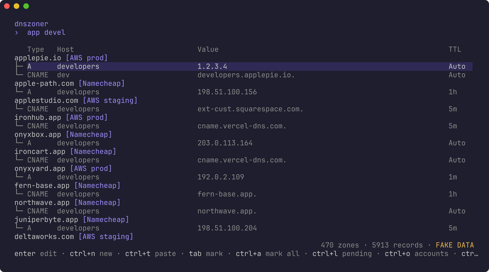
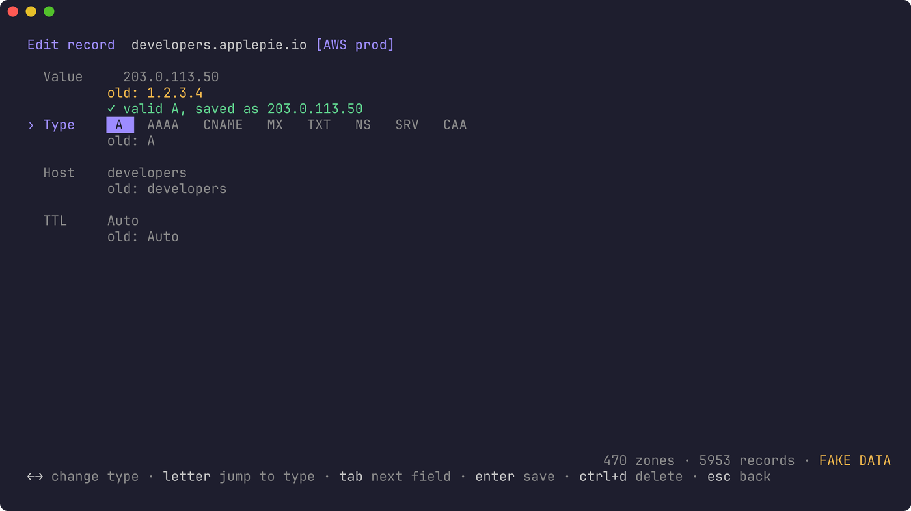
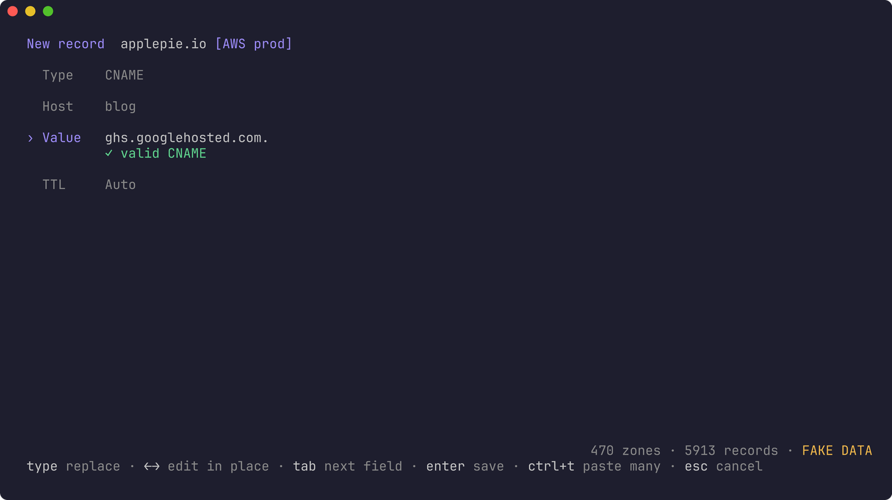
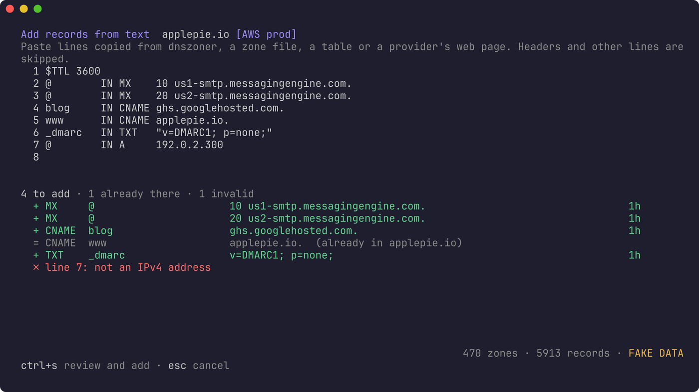
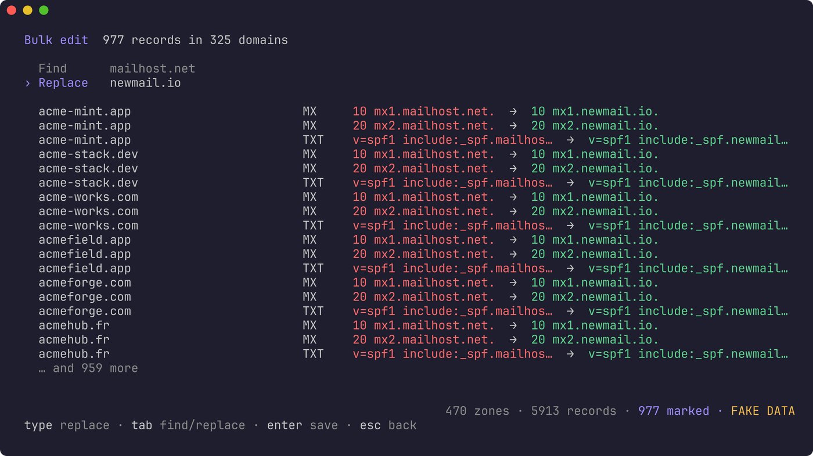
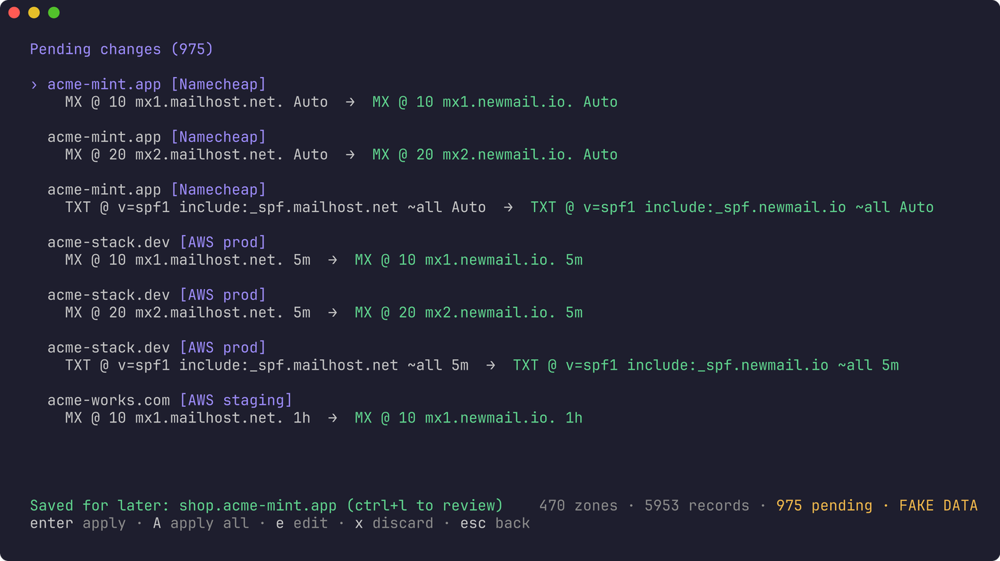
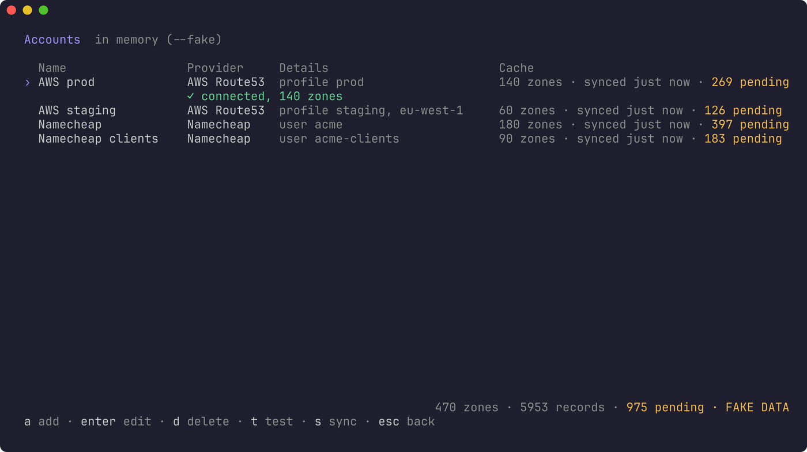
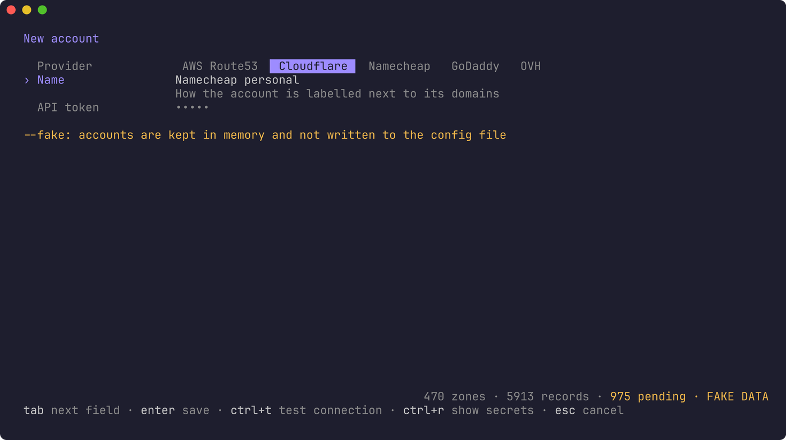

# dnszoner

A terminal editor for DNS zones across providers (AWS Route53, Cloudflare,
Namecheap, GoDaddy and OVH), built for people with a lot of domains.

Every zone and record is cached in SQLite, so the app opens instantly with
everything loaded and refreshes from the providers in the background.

## Search

The first screen is a fuzzy search over domain names, hosts and values. Terms
are matched independently, so `app devel` finds the `developers` record of
`applepie.io`. The top result is selected, and Enter edits it.



## Edit a record

The value is selected when the editor opens, so typing replaces it. Tab moves
to the type, host and TTL. The old value of each field stays visible while
you edit. Enter saves and asks whether to apply now or save for later. ctrl+d
deletes the record.

The type is a selector: ← → cycle through A, AAAA, CNAME, MX, TXT, NS, SRV
and CAA, and typing a letter jumps to the next type starting with it. As you
type, the value is checked against the selected type: an A record must be an
IPv4 address, a CNAME must be a hostname, an MX must be
`<priority> <mail server>`, and so on. Surrounding spaces are trimmed. An
invalid value can't be saved, and bulk edits are checked the same way. The
CNAME rules are checked too: a CNAME isn't allowed at the domain root
(`@`), and a name can't have two. A CNAME sharing its name with other
records is against the DNS rules as well, but some providers accept it, so
that is a warning you can confirm past (Route53 will refuse it).



## Add a record

Press ctrl+n to add a record to the domain of the selected result (search
for the domain first). Domains with no records can be selected too: Enter
adds their first one. The form starts on the type, then the host and the
value, with the same checks as editing. Apply it now or save it for later:
a new record saved for later shows in the results with a `+`, where you can
edit it, or discard it with ctrl+d.



## Add records from text

To add many records at once, press ctrl+t (or ctrl+t in the new record form)
and paste them. dnszoner picks the records out of whatever you paste: lines
copied from its own results, a zone file, a table split by `|` or tabs, or a
provider's web page (`A Record  @  192.0.2.1  Automatic`). Headers, domain
names and other lines are skipped. Each record found is checked as you
paste: new ones are listed for adding, those already in the domain or
repeated are left out, and invalid ones (bad values, CNAME clashes, names
of other domains) are listed with the reason. SOA records and the domain's
own NS records are skipped, as the provider manages them. ctrl+s reviews
the records to add; apply them now or save them for later.



## Bulk find and replace

Mark records with tab (ctrl+a marks every result) and press Enter to change
them all at once. Find is pre-filled when the marked records share a value.
Leave it empty to replace whole values. Matching also works on part of a
value, so replacing `mailhost.net` updates MX records and SPF TXT records
together. The preview shows every record before and after.



## Pending changes

Changes saved for later are listed under ctrl+l. Apply them one by one (Enter)
or all at once (A). Each domain's changes go to the provider in a single
call, with several domains in flight per account. If a record changed at the
provider since the last sync, that change is refused and kept pending; the
rest still apply.



## Install

From a clone of the repository (needs Go 1.21 or later, which fetches the
exact Go version this project uses; no C compiler needed):

```sh
make            # builds ./dnszoner
make install    # or: installs dnszoner into $(go env GOPATH)/bin
```

Without cloning:

```sh
GOPRIVATE=github.com/chrismaximin go install github.com/chrismaximin/dnszoner@latest
```

(`GOPRIVATE` is needed while the repository is private.)

Try it without any account using made-up data (kept in a separate database):

```sh
./dnszoner --fake
```

## Development

```sh
make test          # go vet and the tests
make screenshots   # regenerates the images in docs/
make clean         # removes the built binary
```

## Change log

Every change sent to a provider is appended to a log, one JSON object per
line, with the time, account, domain, record before and after, and whether
it was applied or failed (with the error):

```json
{"time":"2026-10-12T16:04:25Z","level":"INFO","msg":"change applied","source":"AWS prod","zone":"applepie.io","name":"developers.applepie.io","kind":"update","old":{"type":"A","host":"developers","value":"1.2.3.4","ttl":300},"new":{"type":"A","host":"developers","value":"9.9.9.9","ttl":300}}
```

The log lives in `~/.local/state/dnszoner/changes.log` on Linux (or under
`$XDG_STATE_HOME`) and `~/Library/Logs/dnszoner/changes.log` on macOS;
`--log` picks another file. It is readable only by you. With `--fake`,
changes go to `fake-changes.log` next to it instead. Changes saved for later
are logged when they are applied.

```sh
tail -f ~/.local/state/dnszoner/changes.log | jq .                    # follow
jq -c 'select(.level == "ERROR")' ~/.local/state/dnszoner/changes.log  # failures
jq -c 'select(.zone == "example.com")' ~/.local/state/dnszoner/changes.log
```

## Accounts

Press ctrl+o to manage your provider accounts; on first run the app opens
there. Add, edit, delete and test accounts from a form: pick the provider,
and only its settings are shown, each with a hint. Secrets are masked
(ctrl+r shows them), and ctrl+t tests the connection before you save.
Saving an account syncs it straight away. Renaming an account keeps its
cached zones.





Accounts are saved to `config.toml` in your user config directory
(`~/.config/dnszoner/` on Linux, `~/Library/Application Support/dnszoner/`
on macOS; `dnszoner -h` prints the path). It is written readable only by
you, since it holds credentials, and you can also edit it by hand:

```toml
[[sources]]
name = "AWS prod"
provider = "route53"
profile = "prod"

[[sources]]
name = "AWS staging"
provider = "route53"
access_key_id = "AKIA…"
secret_access_key = "…"

[[sources]]
name = "Namecheap"
provider = "namecheap"
api_user = "you"
api_key = "…"
client_ip = "203.0.113.7"

[[sources]]
name = "Cloudflare"
provider = "cloudflare"
api_token = "…"

[[sources]]
name = "GoDaddy"
provider = "godaddy"
api_key = "…"
api_secret = "…"

[[sources]]
name = "OVH"
provider = "ovh"
endpoint = "ovh-eu"
application_key = "…"
application_secret = "…"
consumer_key = "…"
```

- **route53**: uses `profile`, or static keys, or the usual AWS environment
  variables and shared config. `region` is optional.
- **namecheap**: needs API access enabled and your IP whitelisted.
  `client_ip` is discovered automatically when omitted; set `api_endpoint` to
  use the sandbox. Calls are rate limited to stay under Namecheap's API
  limits.
- **cloudflare**: an API token with Zone › Zone › Read and Zone › DNS › Edit.
  Changes are made record by record, and only send the record's own fields,
  so proxying, comments and tags are kept. New records aren't proxied.
- **godaddy**: a Production API key and secret. GoDaddy only opens its API
  to some accounts (by number of domains, or with a Discount Domain Club
  plan); TTLs must be at least 600 seconds, and SRV records can be read but
  not changed yet. Calls are rate limited to 60 a minute.
- **ovh**: an application key, application secret and consumer key with
  GET, POST, PUT and DELETE rights on `/domain/*` (create them at
  `eu.api.ovh.com/createToken`, or the `ca.` / `us.` equivalents, and set
  `endpoint` to match). The zone is refreshed after each change.

## Keys

| Where   | Key            | Action                                  |
| ------- | -------------- | --------------------------------------- |
| Search  | type           | filter                                  |
|         | ↑ ↓ / pgup pgdn | move                                   |
|         | enter          | edit the selected record (or the marked ones) |
|         | ctrl+n         | add a record to the selected domain     |
|         | ctrl+t         | add records from pasted text            |
|         | tab / ctrl+a   | mark the record / mark every result     |
|         | ctrl+l         | pending changes                         |
|         | ctrl+o         | accounts                                |
|         | ctrl+r         | sync from the providers                 |
|         | esc            | clear the search, then the marks, then quit |
| Edit    | type           | replace the selected field              |
|         | ← →            | edit the field in place                 |
|         | ← → / letter   | on the type: change it / jump to it     |
|         | tab            | next field                              |
|         | enter          | save (then enter: apply now, l: later)  |
|         | ctrl+d         | delete the record (discard a new one)   |
| Pending | enter / A      | apply the selected change / all of them |
|         | e / x          | edit / discard the selected change      |
| Accounts | a / enter / d | add / edit / delete an account          |
|         | t / s          | test the connection / sync the account  |

## Flags

```
--config PATH   config file (default: the user config dir)
--db PATH       cache database (default: the user cache dir)
--log PATH      change log (default: the user state or logs dir)
--no-sync       don't refresh from the providers on startup
--fake          use made-up sources, domains and records
--fake-reset    with --fake, regenerate the fake data
```

## Screenshots

The images above are generated from `--fake` data by `make screenshots`
(`scripts/screenshots.sh`; needs tmux, ffmpeg and
[freeze](https://github.com/charmbracelet/freeze)).
